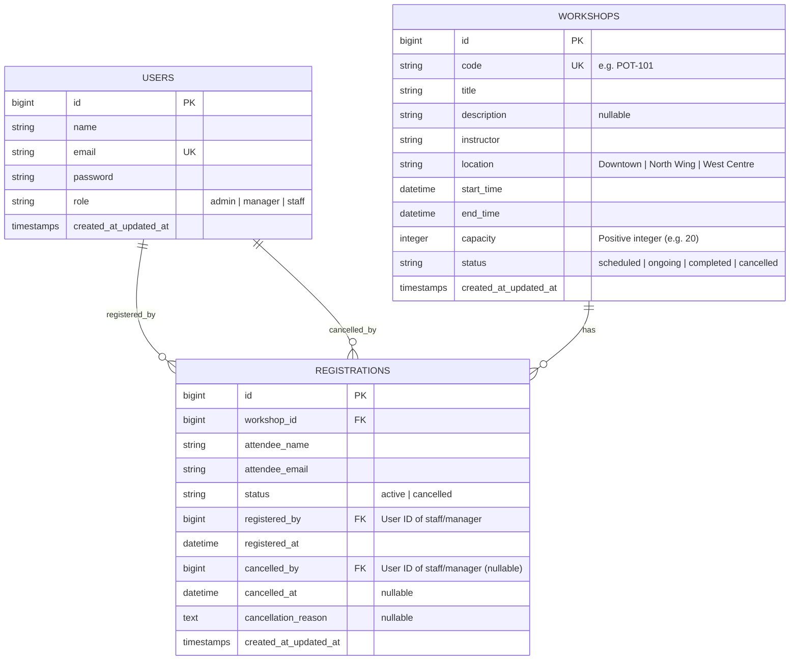
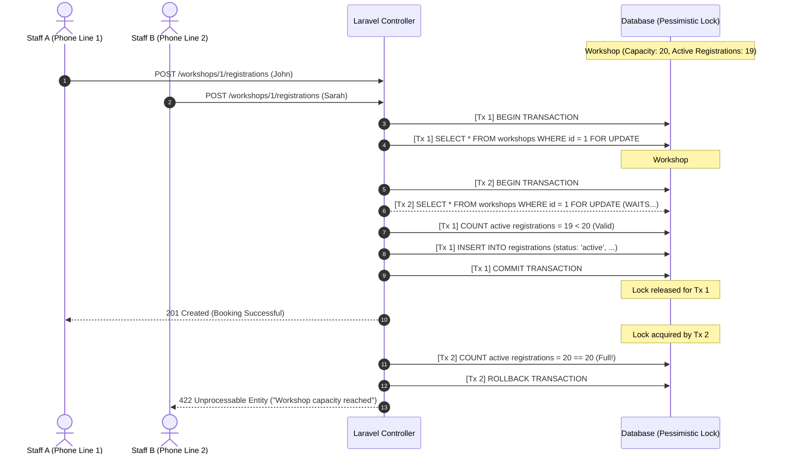

# Workshop Registration Service — System Architecture & Database Design

**Stack:** Laravel 11 + Inertia.js (React) + Tailwind CSS + SQLite / MySQL  
**Target:** 3-Hour Full-Stack Coding Challenge

---

## 1. Executive Summary & Core Requirements

The system is a workshop registration management tool for a community training centre with 3 locations and ~15 staff members.

### Key Objectives:
1. **Strict Backend-Enforced Role-Based Access Control (RBAC):** Three distinct roles (`admin`, `manager`, `staff`). Unauthorized actions must return `403 Forbidden` from the backend API.
2. **Zero Over-Registration (Concurrency Guarantee):** A workshop can **never** exceed its capacity, even when multiple staff register attendees simultaneously under high concurrency (e.g., Saturday morning rush).
3. **Full Audit History:** Attendee registrations and cancellations are never permanently deleted. The system must record who performed each action (`registered_by`, `cancelled_by`) and when.
4. **Workshop Discovery & Filtering:** Fast filtering by date range, workshop status, and availability ("seats still available").
5. **Frictionless Evaluator Setup:** Out-of-the-box SQLite support, pre-seeded users for all 3 roles, sample workshops with realistic registration history, and quick login helpers.

---

## 2. Database Schema & Data Modeling

### 2.1 Entity Relationship Diagram (ERD)



### 2.2 Table Definitions & Migration Specifications

#### Table: `users`
| Column | Type | Modifiers / Constraints | Description |
| :--- | :--- | :--- | :--- |
| `id` | `BIGINT` | Primary Key, Auto Increment | User ID |
| `name` | `VARCHAR(255)` | NOT NULL | Staff member's name |
| `email` | `VARCHAR(255)` | UNIQUE, NOT NULL | Staff login email |
| `password` | `VARCHAR(255)` | NOT NULL | Hashed password |
| `role` | `VARCHAR(30)` | NOT NULL, INDEX | Role: `admin`, `manager`, or `staff` |
| `created_at` | `TIMESTAMP` | NULLABLE | Record creation timestamp |
| `updated_at` | `TIMESTAMP` | NULLABLE | Record update timestamp |

#### Table: `workshops`
| Column | Type | Modifiers / Constraints | Description |
| :--- | :--- | :--- | :--- |
| `id` | `BIGINT` | Primary Key, Auto Increment | Workshop ID |
| `code` | `VARCHAR(50)` | UNIQUE, NOT NULL | Workshop code (e.g., `POT-101`, `COD-202`) |
| `title` | `VARCHAR(255)` | NOT NULL | Workshop title |
| `description`| `TEXT` | NULLABLE | Details / requirements |
| `instructor` | `VARCHAR(255)` | NOT NULL | Name of instructor |
| `location` | `VARCHAR(100)` | NOT NULL | One of the 3 centre locations |
| `start_time` | `DATETIME` | NOT NULL, INDEX | Start datetime |
| `end_time` | `DATETIME` | NOT NULL | End datetime |
| `capacity` | `INT UNSIGNED`| NOT NULL | Total seat limit (e.g., 20) |
| `status` | `VARCHAR(30)` | NOT NULL, DEFAULT 'scheduled', INDEX | `scheduled`, `ongoing`, `completed`, `cancelled` |
| `created_at` | `TIMESTAMP` | NULLABLE | Created timestamp |
| `updated_at` | `TIMESTAMP` | NULLABLE | Updated timestamp |

* **Index:** `INDEX idx_workshops_filter (start_time, status)`

#### Table: `registrations`
| Column | Type | Modifiers / Constraints | Description |
| :--- | :--- | :--- | :--- |
| `id` | `BIGINT` | Primary Key, Auto Increment | Registration ID |
| `workshop_id`| `BIGINT` | FK -> `workshops.id` (CASCADE), NOT NULL | Linked workshop |
| `attendee_name` | `VARCHAR(255)` | NOT NULL | Attendee full name |
| `attendee_email`| `VARCHAR(255)` | NOT NULL | Attendee contact email |
| `status` | `VARCHAR(30)` | NOT NULL, DEFAULT 'active', INDEX | `active` or `cancelled` |
| `registered_by` | `BIGINT` | FK -> `users.id` (RESTRICT/SET NULL), NOT NULL | Staff user who registered attendee |
| `registered_at` | `DATETIME` | NOT NULL | Timestamp when registered |
| `cancelled_by` | `BIGINT` | FK -> `users.id` (RESTRICT/SET NULL), NULLABLE | Staff user who cancelled registration |
| `cancelled_at` | `DATETIME` | NULLABLE | Timestamp when cancelled |
| `cancellation_reason` | `TEXT` | NULLABLE | Optional reason for cancellation |
| `created_at` | `TIMESTAMP` | NULLABLE | Created timestamp |
| `updated_at` | `TIMESTAMP` | NULLABLE | Updated timestamp |

* **Composite Index:** `INDEX idx_registrations_active_count (workshop_id, status)`

---

## 3. Strict RBAC Matrix & Policy Rules

Per the challenge requirements: **"Anything not marked must be refused by the backend, not just hidden in the interface."**

| Action / Capability | Admin | Manager | Staff | Enforced Via |
| :--- | :---: | :---: | :---: | :--- |
| **Create user accounts & set roles** |  **Yes** | ❌ (403) | ❌ (403) | `UserPolicy@create` / `RoleMiddleware:admin` |
| **Add & edit workshops** | ❌ (403) |  **Yes** | ❌ (403) | `WorkshopPolicy@create,update` |
| **Register & cancel attendees** | ❌ (403) |  **Yes** |  **Yes** | `RegistrationPolicy@create,cancel` |
| **View workshops, registrations & history** | ❌ (403) |  **Yes** |  **Yes** | `WorkshopPolicy@viewAny,view` |

### Route Definitions & Gates
```php
// Admin-only Routes
Route::middleware(['auth', 'role:admin'])->prefix('admin')->group(function () {
    Route::resource('users', UserController::class)->only(['index', 'store', 'update']);
});

// Operations (Manager & Staff) Routes
Route::middleware(['auth', 'role:manager,staff'])->group(function () {
    Route::get('/workshops', [WorkshopController::class, 'index'])->name('workshops.index');
    Route::get('/workshops/{workshop}', [WorkshopController::class, 'show'])->name('workshops.show');
    
    // Registrations
    Route::post('/workshops/{workshop}/registrations', [RegistrationController::class, 'store'])->name('registrations.store');
    Route::post('/registrations/{registration}/cancel', [RegistrationController::class, 'cancel'])->name('registrations.cancel');
    
    // Manager-only actions on Workshops
    Route::middleware('role:manager')->group(function () {
        Route::get('/workshops/create', [WorkshopController::class, 'create'])->name('workshops.create');
        Route::post('/workshops', [WorkshopController::class, 'store'])->name('workshops.store');
        Route::get('/workshops/{workshop}/edit', [WorkshopController::class, 'edit'])->name('workshops.edit');
        Route::put('/workshops/{workshop}', [WorkshopController::class, 'update'])->name('workshops.update');
    });
});
```

---

## 4. Concurrency & Over-Registration Prevention

### 4.1 Sequence Diagram: Pessimistic Row Locking



### 4.2 Concurrency Implementation Pattern

```php
namespace App\Actions;

use App\Models\Workshop;
use App\Models\Registration;
use Illuminate\Support\Facades\DB;
use Illuminate\Validation\ValidationException;

class RegisterAttendeeAction
{
    public function execute(int $workshopId, array $data, int $staffUserId): Registration
    {
        return DB::transaction(function () use ($workshopId, $data, $staffUserId) {
            // 1. Lock workshop row to prevent concurrent race conditions
            $workshop = Workshop::where('id', $workshopId)->lockForUpdate()->firstOrFail();

            // 2. Compute active registration count within the transaction lock
            $activeCount = $workshop->registrations()
                ->where('status', 'active')
                ->count();

            if ($activeCount >= $workshop->capacity) {
                throw ValidationException::withMessages([
                    'capacity' => 'Registration failed: This workshop has just reached its maximum capacity of ' . $workshop->capacity . ' seats.'
                ]);
            }

            // 3. Persist registration with complete audit data
            return $workshop->registrations()->create([
                'attendee_name'  => $data['attendee_name'],
                'attendee_email' => $data['attendee_email'],
                'status'         => 'active',
                'registered_by'  => $staffUserId,
                'registered_at'  => now(),
            ]);
        });
    }
}
```

---

## 5. Frontend Architecture (Inertia.js + React)

```
resources/js/
├── Layouts/
│   ├── AuthenticatedLayout.jsx   # Top navigation, role badge, quick user switcher, flash alerts
│   └── GuestLayout.jsx           # Clean centered auth layout
├── Pages/
│   ├── Auth/
│   │   └── Login.jsx             # Login form + "Quick Demo Login" buttons (Admin, Manager, Staff)
│   ├── Admin/
│   │   └── Users/
│   │       └── Index.jsx         # User account list & modal to create staff/manager with role assignment
│   ├── Workshops/
│   │   ├── Index.jsx             # Workshop Catalogue with search, date filters, availability toggle
│   │   ├── Show.jsx              # Workshop details, remaining seats, attendee list & cancellation audit
│   │   └── Form.jsx              # Create / Edit Workshop form (Manager only)
└── Components/
    ├── WorkshopFilters.jsx       # Filter by Date Range, Status, Only Available Seats
    ├── SeatAvailabilityBadge.jsx # Green/Yellow/Red badge ("18/20 seats - 2 left" or "FULL")
    ├── RegisterAttendeeModal.jsx # Quick popup form to register name & email
    ├── CancelModal.jsx           # Confirmation modal + optional cancellation reason
    └── RegistrationHistory.jsx   # Tabbed view: Active Attendees vs Cancelled Audit Trail
```

---

## 6. Seed Data & Evaluator Experience

### 6.1 Pre-seeded Credentials
* **Admin:** `admin@centre.test` | Password: `password`
* **Manager:** `manager@centre.test` | Password: `password`
* **Staff:** `staff@centre.test` | Password: `password`

### 6.2 Pre-seeded Sample Data
* **Locations:** Downtown, North Wing, West Centre.
* **Workshops:** 5 realistic workshops (Pottery Basics, Python Intro, Weekend Fitness, Digital Photography, Woodworking).
* **Sample Scenarios:**
  * 1 Workshop with plenty of seats left.
  * 1 Workshop with only 1 seat left (ideal for testing the race condition).
  * 1 Workshop completely fully booked.
  * Workshops containing both active registrations and cancelled audit history records.

---

## 7. Setup & Execution Commands

```bash
# 1. Install dependencies
composer install
npm install

# 2. Setup environment & database
cp .env.example .env
touch database/database.sqlite
php artisan key:generate
php artisan migrate --seed

# 3. Build & Run
npm run build
php artisan serve
```
