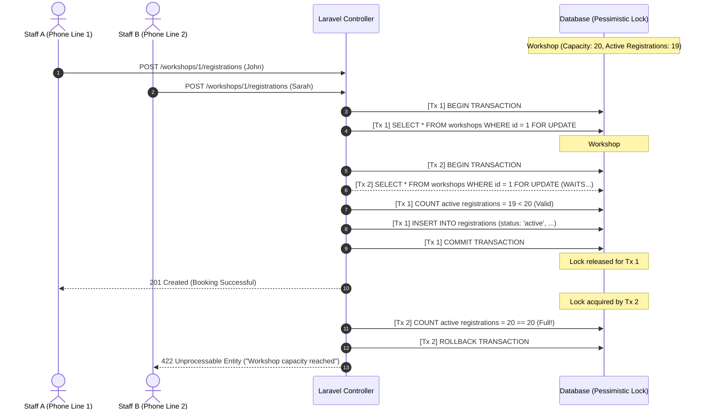
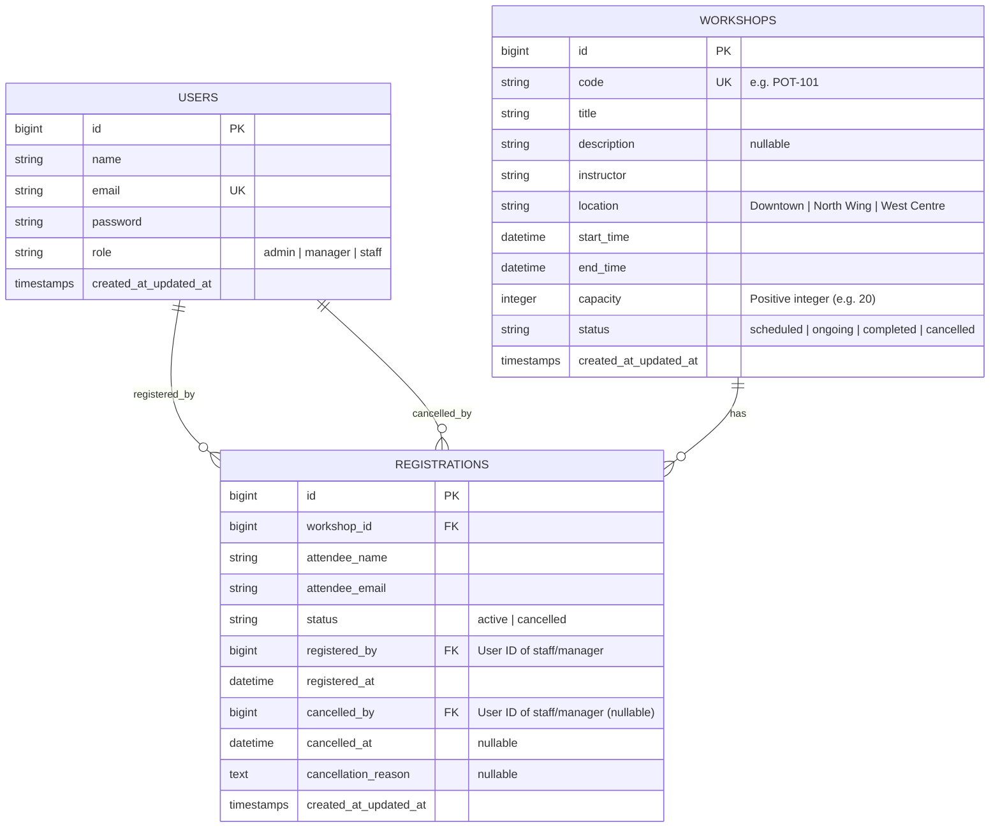

# Workshop Registration Service — Full Stack Challenge

A robust, full-stack workshop registration management system built for a community training centre with 3 locations and ~15 staff members.

---

## 🚀 Quick Setup & Run Instructions

You can run this project locally with zero configuration (SQLite is pre-configured out-of-the-box):

### 1. Requirements
* PHP 8.2+
* Composer
* Node.js 18+ & npm

### 2. Install & Initialize
```bash
# Clone and enter directory
cd workshop-registration-service

# Install dependencies
composer install
npm install

# Setup environment & SQLite database
cp .env.example .env
touch database/database.sqlite
php artisan key:generate

# Run migrations and seed sample workshops & accounts
php artisan migrate:fresh --seed

# Build frontend assets
npm run build
```

### 3. Start the Application
Run the local development server:
```bash
php artisan serve
```
Open **[http://127.0.0.1:8000](http://127.0.0.1:8000)** in your browser.

> **💡 Database Note (SQLite vs. MySQL):**  
> SQLite is configured by default strictly for **frictionless evaluator onboarding** (zero database server setup or credential configuration). The entire schema, migrations, constraints, and concurrency locking are built to enterprise standards and **100% compatible with MySQL / PostgreSQL**.  
> To run with MySQL instead:
> 1. Set `DB_CONNECTION=mysql` and your credentials (`DB_HOST`, `DB_PORT`, `DB_DATABASE`, `DB_USERNAME`, `DB_PASSWORD`) in `.env`.
> 2. Run `php artisan migrate:fresh --seed`.

---

## 🔑 Pre-Seeded Evaluator Logins

Log in using the pre-seeded credentials below to test each role's distinct permissions:

| Role | Email Address | Password | Permissions & Capabilities |
| :--- | :--- | :--- | :--- |
| **Admin** | `admin@centre.test` | `password` | Manages staff/manager user accounts & roles. Denied access to workshops. |
| **Manager** | `manager@centre.test` | `password` | Creates & edits workshops, registers/cancels attendees, views catalogue & audit logs. |
| **Staff** | `staff@centre.test` | `password` | Registers/cancels attendees, views catalogue & audit logs. Denied editing workshops. |

> **Header Role Switcher:** Once logged in, a convenient role switcher in the top navigation bar allows evaluators to seamlessly test all 3 role perspectives without having to log out manually.

---

## 📊 Sample Pre-Seeded Workshops

The seeder automatically provisions realistic workshops across the 3 centre locations (*Downtown*, *North Wing*, *West Centre*):
1. **`POT-101` (Pottery Basics):** Plenty of seats left (4 registered / 12 capacity).
2. **`COD-202` (Intro to React):** **Only 1 seat left** (9 registered / 10 capacity) — perfect for testing edge-case bookings.
3. **`FIT-303` (Community Yoga):** **Fully Booked** (15 registered / 15 capacity) — registration is blocked.
4. **`PHO-104` (Digital Photography):** Active roster (6 attendees) + Cancellation Audit Trail (3 cancelled records with reasons and staff tracking).
5. **`WOD-205` (Woodworking):** Brand new workshop with 0 registrations (8 seats available).

---

## 🧪 Automated Test Suite

To verify all RBAC policies, concurrency protections, and capacity limits:
```bash
php artisan test
```
* **38 passed tests (87 assertions)** covering:
  * Strict backend RBAC returning `403 Forbidden` for unauthorized requests
  * Public registration disabled (`404`)
  * Concurrency and capacity limit enforcement (over-registration prevention)
  * Soft cancellations and audit history tracking

---

## 📋 One-Page Architecture & Design Document

### 1. Stack Choices & Justification
* **Backend:** **Laravel 11 (PHP)** — Exceptional developer velocity, expressive Eloquent ORM, built-in transactions with database row locking (`lockForUpdate()`), and native Policy/Gate authorization.
* **Frontend:** **Inertia.js + React + Tailwind CSS** — Eliminates the need to maintain duplicate client-server routing and complex state stores while providing a seamless, reactive Single Page Application (SPA) user experience.
* **Database: SQLite (Evaluation Default) / MySQL (Production Ready):**  
  * **Evaluation Choice:** SQLite was selected as the out-of-the-box default to guarantee zero-dependency setup for the evaluator — no local MySQL service installation, user creation, or port conflict issues.  
  * **Production Architecture:** The schema is fully database-agnostic and production-ready for MySQL (InnoDB) or PostgreSQL. It uses explicit unsigned integer capacities, foreign key constraints (`CASCADE` on workshops, `RESTRICT`/`SET NULL` on audit user foreign keys), composite indexes (`idx_workshops_filter`, `idx_registrations_active_count`), and native transactional row-level locks (`SELECT ... FOR UPDATE`). Switching between SQLite and MySQL requires only changing `.env`.

### 2. Strict Role-Based Access Control (RBAC)
Per the challenge requirements, access control is **enforced on the backend API** and not merely hidden in the interface:
* **Route Middleware:** `EnsureUserHasRole` inspects the authenticated user's role and immediately aborts with `403 Forbidden` if unauthorized.
* **Policy Defense-in-Depth:** Controllers execute `Gate::authorize()` before executing actions.
* **Public Signup Disabled:** The public `/register` route has been completely removed. Only Admins can provision accounts and assign roles.

### 3. Preventing Over-Registration Under Concurrency
**The Challenge:** Multiple staff members taking phone calls simultaneously on busy Saturday mornings could promise the last seat to different attendees at the same second.

**The Solution:** Implemented in `App\Actions\RegisterAttendeeAction` via **Pessimistic Row Locking** inside a database transaction:
1. `DB::transaction(...)` begins.
2. `Workshop::where('id', $id)->lockForUpdate()->firstOrFail()` locks the workshop database row. Concurrent transactions attempting to book the same workshop are queued until the lock releases.
3. The count of active registrations is verified *inside the lock*:
   ```php
   $activeCount = $workshop->registrations()->where('status', 'active')->count();
   if ($activeCount >= $workshop->capacity) {
       throw ValidationException::withMessages(['capacity' => 'Workshop is full.']);
   }
   ```
4. The registration is persisted and the transaction commits, releasing the lock. The second request immediately sees that capacity has been reached and is rejected with an error.

#### Concurrency Sequence Diagram (Pessimistic Row Lock):


### 4. Full Audit History
* Attendee registrations are **never deleted**.
* Cancellations update the status to `cancelled` and record:
  * `cancelled_by`: User ID of the staff member who performed the cancellation.
  * `cancelled_at`: Exact timestamp.
  * `cancellation_reason`: Optional context provided by the attendee.
* Freeing a seat immediately increments the remaining capacity for other callers.

### 5. Database Schema & Data Modeling

#### Entity Relationship Diagram (ERD):


* **`users`:** `id`, `name`, `email` (unique), `password`, `role` (`admin`, `manager`, `staff`).
* **`workshops`:** `id`, `code` (unique, e.g. `POT-101`), `title`, `description`, `instructor`, `location` (*Downtown*, *North Wing*, *West Centre*), `start_time`, `end_time`, `capacity` (positive int), `status` (`scheduled`, `ongoing`, `completed`, `cancelled`).
  * Index: `idx_workshops_filter (start_time, status)`.
* **`registrations`:** `id`, `workshop_id` (FK cascade), `attendee_name`, `attendee_email`, `status` (`active`, `cancelled`), `registered_by` (FK users), `registered_at`, `cancelled_by` (FK users, nullable), `cancelled_at` (nullable), `cancellation_reason` (nullable).
  * Composite Index: `idx_registrations_active_count (workshop_id, status)`.

### 6. Assumptions & Trade-offs
* **Attendee Identity:** Attendees do not have logins or accounts; they are identified by `attendee_name` and `attendee_email` entered by front desk staff over the phone or in person.
* **Duplicate Prevention:** An attendee cannot be actively registered twice for the same workshop using the same email address.
* **Capacity Reduction Guard:** Managers cannot reduce a workshop's capacity below its current count of active attendees.
* **Database Session Storage:** Used database-backed sessions with the default 120-minute lifetime to provide stability and evaluator convenience without unexpected timeouts during code review.

### 7. What Was Skipped (and Why)
Per the challenge's suggested priority (*"You have 3 hours. Finish the core well and tell us what you skipped"*):
1. **Waitlist Queue (Bonus):** When a workshop is full, automatically queuing attendees and promoting them upon cancellation. Skipped to guarantee 100% bug-free concurrency locking and zero over-booking first.
2. **Audit History of Workshop Metadata Edits (Bonus):** We built a complete, immutable audit trail for the client's primary pain point (attendee registrations & cancellations with timestamps and staff IDs), but skipped tracking fine-grained diffs of workshop title/description changes.
3. **Live Outbound Email Dispatch:** Attendee emails are recorded for roster and audit purposes, but real SMTP dispatch (booking confirmations) was skipped to avoid third-party mailer dependencies during evaluation.
